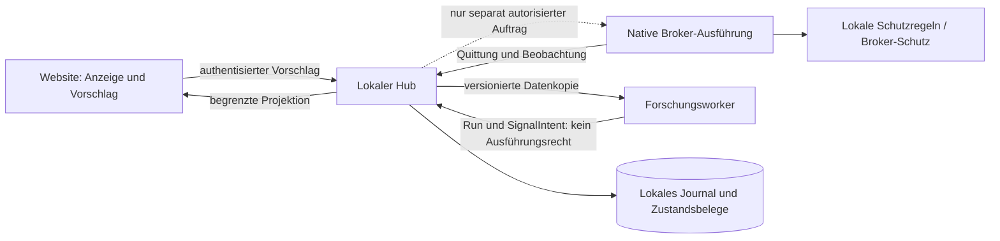

# ExtremeLab · S02 – Zielarchitektur und nachgewiesene Grenzen

**Plan 1.2.0; Basis 2426d406ee488fd808edbb5e0beb0bac754eadf3.** S00/S01 sind lokal abgeschlossen. Diese Architektur ist ein privater Vertragsstand, keine Produktinstallation. Alle bisherigen Originale und Korrekturvorschläge bleiben getrennt. Quellenkennungen und genaue Archivmember/Hashes stehen in `source-bindings.json`; der vorhandene Ist-Katalog liegt unter `baseline/s01_reference/docs/architecture/existing-interfaces.md`.

## 1. Vier Verantwortungsbereiche

| Bereich | Zuständigkeit | Tatsächlich vorhandene Grundlage | Nicht zuständig |
|---|---|---|---|
| Website / Bedienung | Projektionen, Quellenalter, Forschungsergebnisse, Vorschläge und explizite Bestätigung anzeigen | Gesicherte 38 Websiteinputs; `integrations/vercel-view20` und lokale Bedienung im Plattformarchiv | Geheimnisinhaber, Risikowächter, Wahrheit über Brokerfüllung |
| Lokaler Hub / Journal | Authentisierung, dauerhafte Originalereignisse, gewünschte/gemeldete/bestätigte Zustände, Inbox/Outbox und lokale Steuerprüfung | `core/control.mjs`, `store.mjs`, `observation.mjs`, `engine-journal.mjs`, `registry.mjs` | Eine Forschungsantwort als Order interpretieren; Brokerzustand aus UI ableiten |
| Forschungsworker | Versionierte Daten, reproduzierbare Features, Hypothesen, Simulationen und Signalvorschläge | Vorhandene Quellen/Referenzen aus S01; produktive Joborchestrierung ist S17, nicht bereits vorhanden | Kontogeheimnisse, native Orderübermittlung, automatische Policy-Aktivierung |
| Native Ausführung | Kontobindung, eigener Risikoprüfer, Quantisierung, tatsächliche Orderübermittlung und Schutzverwaltung | cTrader-nahe C#-Quellen und `sdk/HubBridge.cs`; C#-abhängigkeitsfreier Kern wird später extrahiert | UI-Verfügbarkeit voraussetzen; Signal ohne eigenständige Freigabekette ausführen |

### Datenfluss – Zielstruktur, keine bereits installierten Verbindungen

Der gestrichelte Pfeil bezeichnet einen Zielvertrag, keine in S02 gebaute Orderroute. Das bestehende Hub-Capabilityprofil beschreibt Voraussetzungen, ist aber ausdrücklich kein Autorisierungstoken (`capabilities`). Der bestehende MCP-Registry-Consumer erlaubt Lesen beziehungsweise Vorschlagen; direkte Ordertools sind nicht vorhanden (`registry`, `original-core-tests`).

## 2. Zustandswahrheit statt eines generischen „Botstatus“

`desired` ist Wunsch, `proposed` ist Vorschlag, `pending` ein übertragener/zu übertragender Auftrag, `reported` eine Meldung und `confirmed actual` ein revisions- und laufzeitgebundener Readback/ACK. Ein Heartbeat mit neuen Werten darf keinen ungeklärten Auftrag eigenmächtig bestätigen. Der vorhandene Control-Code erzwingt dies bereits; die Originaltests werden in diesem Lauf erneut ausgeführt.

Eine lokale Konfigurationsquittung ist **keine** Brokerorderquittung. `BrokerOrder`, `Deal` und `Position` bleiben getrennte Fachobjekte. `unknown` ist weder „keine Position“ noch „flat“. `broker_protection_status=confirmed` benötigt einen Belegverweis; der Verweis allein ist noch keine kryptografische oder unabhängige Brokerbestätigung.

Das Envelope-Feld `account_state` unterscheidet `known`, `stale`, `unknown` und `not_applicable`. Davon unabhängig ist das Kontomodell `hedging/netting/unknown`. Ausführbare Intentprüfung verlangt einen bekannten Kontozustand und ein bekanntes Modell; tatsächliche Aktualität und Herkunft müssen später von der Ausführungsgrenze bestätigt werden.

## 3. Bestehende Datenwege nicht vermischen

| Originalweg | Bedeutung | V1-Ziel und Grenze |
|---|---|---|
| `/api/bridge/heartbeat` | Profil-, Laufzeit-, Kontobindung und Konfigurationszustand | Keine Order oder Deal erzeugen; Originalmanifest mitführen |
| `/api/bridge/observation` / Observation v1 | Nichtatomarer beobachteter Bestand, Coverage und Quellzeit | Position als Beobachtung; keine erfundene Originalstrategie/Fillhistorie |
| `/api/bridge/journal` / JournalBatch20 v1 | Ereignisse plus lückenlose Projektionsgrenze | Neue abgeleitete Domainereignisse nur mit Quellen- und Adapterbindung |
| `get_bot_reconciliation` / reconciliation20 | Passiver Vergleich expliziter Profile und exakter IDs | Differenzbericht, kein Handelsauftrag |
| `/api/revolution?action=receive` / th3rev20_readonly v1 | Verlustbehaftete Fernansicht | Anzeige; kein Replay- oder Restore-Ersatz |
| Älteres XL1/XL2 `run/kind/utc/data` | Separater alter Telemetrievertrag | Versionierter Leser, kein automatischer Ersatz für Observation/JournalBatch20 |

`schemaVersion=1` in diesen verschiedenen Dokumenten bezeichnet **nicht** denselben Vertrag. Der fehlende JavaScript-Relay ist nicht durch den vorhandenen Python-Relay ersetzt. MT5-Verträge sind in den ausgewerteten Originalmodulen nicht nachgewiesen; ein MT5-Ausführungspfad bleibt ausdrücklich unimplementiert.

## 4. Domänen- und Zahlenvertrag

Die zwölf Modelle und vollständigen Felddefinitionen stehen in `contracts/domain/v1/schema.json`; `domain-contract.json` bindet dessen SHA-256. Jeder Event trägt Quellvertrag, Datenversion, Stream/Sequenz, Run, relevante Instrument-/Policy-Version, Coverage, Zeitfelder und Payloadhash. Unbekannte Felder werden auf jeder Objektebene verworfen, nicht stillschweigend ignoriert.

| Typengruppe | Fachliche Grenze |
|---|---|
| InstrumentVersion / Quote / Bar | Versionierter Kontrakt und Quellmarktwerte; Symbolname allein genügt nicht |
| FeatureSnapshot / SignalIntent | Daten- und Formelversion sowie Vorschlag ohne Ausführungsrecht |
| OrderIntent / BrokerOrder / Deal | Absicht, gemeldeter Orderzustand und tatsächliche Ausführungsmeldung sind verschieden |
| Position / Cashflow | Bestand und Buchung; eine Einzahlung benötigt kein künstliches Instrument |
| Run / PolicyVersion | Reproduktionsbasis beziehungsweise revisionierte, nicht durch das JSON selbst aktivierte Regeln |

Geld, Preis und Mengen sind kanonische Dezimalzeichenketten. Kein exponentieller Text, NaN, Infinity, führende Null oder `-0`; keine stillschweigende Double-/Decimal-Rundung. IDs/Sequenzen sind ebenfalls Strings; Sequenzen sind UInt64 und lokal zum Quellstream. Preis trägt Quote-Währung und Basiseinheit. Menge trägt Units/Stück/Lots, Instrumentversion und Umrechnungsversion. Pip und Tick sind Abstände, keine Geldbeträge. Kontowährung ist separat; ein Kurs in USD pro Unit ist keine CHF-Buchung. FX-Bewertung benötigt künftig eine eigene belegte Umrechnung.

Python verwendet exakte rationale Arithmetik, JavaScript BigInt-Brüche. Die C#-DTOs bewahren Zahlen als Strings, nicht als `double` oder grössenbeschränktes `decimal`. Deren nativer Roundtrip ist vorbereitet, aber noch nicht ausgeführt. Der C#-Probe prüft Wireform/Typisierung, nicht Risikofreigabe.

**Wichtige Legacy-Abbildung:** In vorhandenen Hubprofilen bedeutet `positions=0` budgetgesteuert ohne zusätzliche Anzahlgrenze (`schema`). Im neuen Vertrag steht dafür `maximum_positions=null`; `0` bedeutet keine neuen Positionen. Diese Umdeutung darf nie ohne versionierten Adapter geschehen. Prozentwerte werden ausdrücklich durch 100 in Bruchteile umgerechnet (3 Prozent → `0.03`, 300 Prozent Marginlevel → `3`). Ready20-spezifische Szenario-/Symbolrisiken werden nicht beim Übertragen in eine verkürzte Policy gelöscht: bis ihr vollständiger Vertrag vorhanden ist, bleibt eine solche Policy-Konvertierung gesperrt.

## 5. Zeit und Kausalität

UTC-Zeittext mit genau sechs Nachkommastellen: `YYYY-MM-DDTHH:mm:ss.ffffffZ`. Kalenderdatum wird geprüft; Schaltsekunden sind in v1 nicht zugelassen. Höhere Präzision darf nicht still abgeschnitten werden. Unbekannt bleibt `null`, nicht Empfangszeit oder Nullzeit.

Sechs verschiedene Felder: `event_time`, `available_at`, `received_at`, `features_ready_at`, `decision_at`, `execution_not_before`. OrderIntent verlangt alle sechs, kausale Reihenfolge und eine streng spätere Ablaufzeit. Dadurch kann keine erst später verfügbare Information die dokumentierte frühere Entscheidung legitimieren. Nicht synchronisierte Uhren benötigen vorgelagerten Qualitätsnachweis; bloße Zeitstrings beweisen keine reale Uhrgenauigkeit.

## 6. Dauerhafte Ereignisse, Wiederholung und Ausführung

Inboxschlüssel: `(source_id, stream_id, sequence)`. Identische Wiederholung bedeutet gleicher **vollständiger kanonischer Event**, nicht nur gleicher Payloadhash. Bei gleicher Identität und verändertem Envelope oder Inhalt: Konflikt/quarantäne, nie Überschreiben. Ein neuer Quellstart benötigt neue Stream-ID. Bestätigung erst nach dauerhafter Speicherung. Lückenhafte Sequenz darf gespeichert werden, aber keine lückenlose Projektion oder Handelsfreigabe vortäuschen.

Outbox und fachliche lokale Änderung gehören in dieselbe lokale Transaktion. Übertragung darf at-least-once erfolgen; Empfänger benötigt Idempotenz. Ein Übertragungstimeout ist `unknown delivery`, nicht „nicht ausgeführt“. Vor erneutem Brokerwrite sind externe Orderreferenz und tatsächlicher Brokerzustand abzugleichen. Weder SQLite noch ein Payloadhash beweisen über mehrere Hosts hinweg exactly-once.

Order-Idempotenz bindet Konto, Umgebung, Instrumentversion, komplette Absicht und Policyrevision. Änderung derselben Kennung ist ein Konflikt. Aufbewahrung der Belege und Wiederherstellung sind explizite spätere S06/S25-Aufgaben; keine stille Löschung durch S02. Die bisherigen privaten Frist-/ACK-Patches bleiben Vorschläge und werden durch dieses Architekturpaket nicht auf Originalquellen angewendet.

## 7. Berechtigungs- und Ausfallgrenze

`capability-matrix.json` benennt die getrennten Rechte. Ein Forschungsresultat, MCP-Zugang, gültiges Schema oder angezeigtes `available` ist **keine** Ausführungsgenehmigung. Die Zielkette verlangt authentisierte Betreiberfreigabe, Account/Umgebung, bestätigte Policy, Zustand, lokalen Risikocheck, native Quantisierung und erneute Prüfung unmittelbar vor dem Dispatch. Hier existiert bewusst keine Funktion, die einen Broker aufruft.

Die Website hält keinen autoritativen Schutzstatus. Ohne Website bleiben bestätigte Werte im lokalen Store; Neustart macht die Ausführungsberechtigung wieder gesperrt, nicht die Historie falsch. Die Originaltests und zusätzliche Ausfallprüfung öffnen denselben SQLite-Stand neu. Der native SDK-Code blockiert neue Eintritte bei Kommunikations-/Readbackfehlern (`native-bridge`); ein Brokerstop ist trotzdem nur mit Brokerbeleg bestätigt. Kein Test dieses Pakets behauptet reale Schutzorder, Stromausfallsicherheit oder gestarteten C#-Bot.

## 8. Migration, Pfade und Rücknahme

Vertrag v1 ist eine additive Seitenstrecke. Bestehende Reader bleiben unverändert; neue Adapter benötigen Originalformat, Version und Quellenhash. Unbekannte/fehlende Felder werden nicht aus Anzeigeprojektionen erfunden. Alte Entscheidungen bleiben unverändert mit ihrem damaligen Vertrag. Rücknahme: neuen Adapter deaktivieren, Originalreader beibehalten, abgeleitete Ereignisse nicht rückwirkend neu etikettieren.

`scope-resolution-draft.json` bindet alle späteren Karten an vorhandene Donoren beziehungsweise ausdrücklich neue Zielpfade. Es ist ein **nicht aktiviertes** Änderungsdokument. S03 bleibt Dokumentation; S21 keine CSS-/Layoutarbeit; S30–S35 behalten Designgates. Ohne erfolgreiche C#-Prüfung und nachweisgebundenes Scope-Amendment wird weder S02 als bestanden geschrieben noch ein Folgeschritt gestartet.

## 9. Konkrete Nachweisgrenzen

Neue Python-/JavaScript-Tests prüfen die tatsächlichen Validatoren gegen gemeinsame Original-Testdaten und gezielte Negativfälle. Originale Hub-/SQLite-Tests prüfen aktuelle vorhandene Berechtigungs- und Wiederanlaufmechanismen. Der native C#-Probe ist kein nachgebauter cTrader-Bot; er muss separat tatsächlich gebaut und ausgeführt werden. Das finale JSON-Protokoll enthält genau die neu ausgeführten Prüfungen. S01-Bestand 38/59 und ursprünglicher Plan bleiben unverändert.
